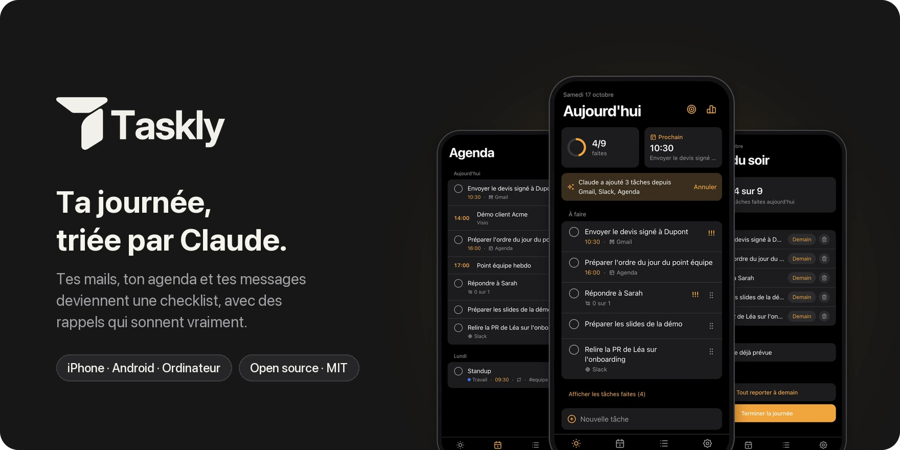
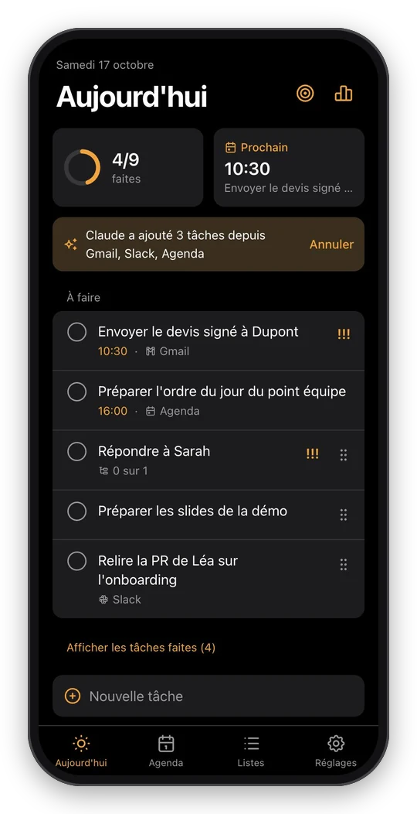
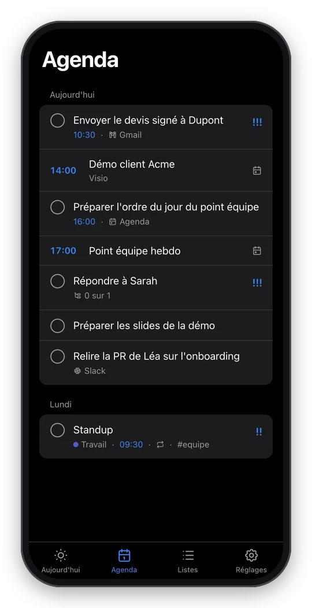
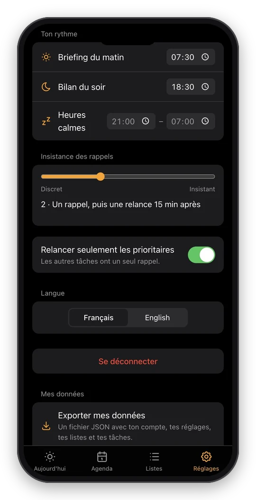
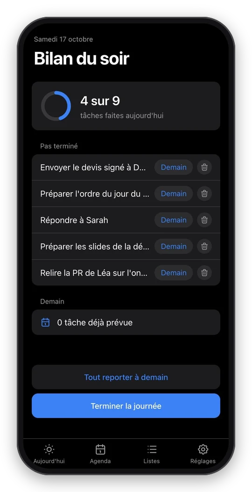
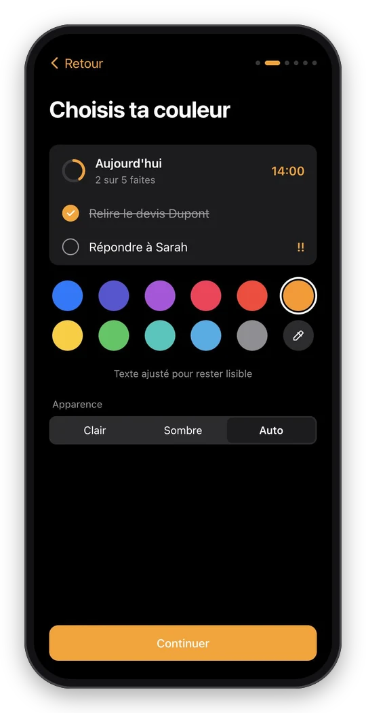
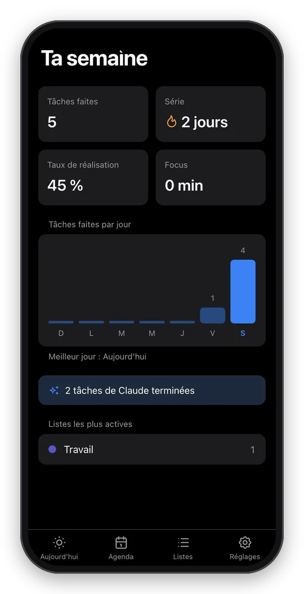
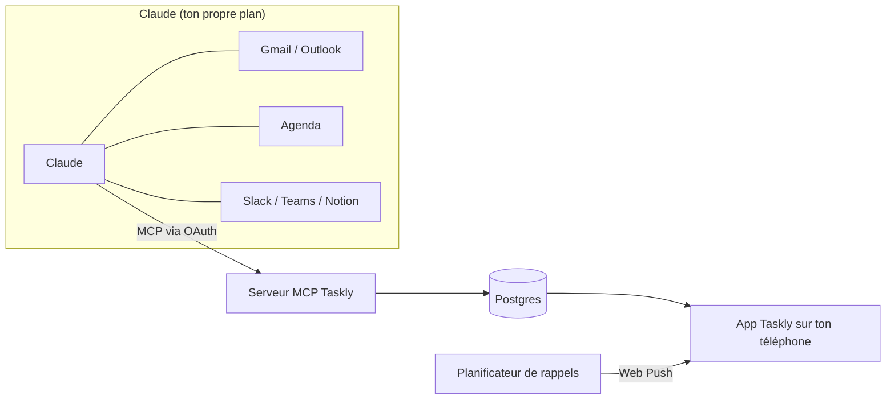

<p align="center">
  
</p>

<p align="center">
  <a href="https://github.com/ethanfrq/Taskly/releases"></a>
  <a href="LICENSE"></a>
  
  
</p>

<p align="center">
  <b><a href="#demarrer">Démarrer</a></b> ·
  <a href="docs/self-hosting.md">Héberger</a> ·
  <a href="docs/connect-claude.md">Connecter Claude</a> ·
  <a href="CONTRIBUTING.md">Contribuer</a> ·
  <a href="README.md">English</a>
</p>

<br>

Taskly est une **todo list du jour open source** que tu installes sur ton téléphone. Tu la connectes à Claude une fois ; ensuite, chaque matin, Claude lit tes mails, ton agenda et tes messages et remplit ta journée avec ce qu'il y a vraiment à faire. Taskly prend le relais : une checklist claire, et des rappels à la bonne minute.

> [!NOTE]
> **Bêta.** Toutes les fonctions prévues sont là, testées et documentées, mais aucune instance publique n'a encore fait tourner Taskly longtemps. [Les retours sont bienvenus.](https://github.com/ethanfrq/Taskly/issues)

## ✨ Ce que fait Taskly

<table>
<tr>
<td align="center" valign="top" width="33%">
<br>
<b>🤖 Claude prépare ta journée</b><br>
<sub>Dis « Prépare ma journée dans Taskly » : tes mails, ton agenda et tes messages deviennent des tâches, reliées à leur source.</sub>
</td>
<td align="center" valign="top" width="33%">
<br>
<b>📅 Une seule timeline</b><br>
<sub>Réunions et tâches des deux prochaines semaines, dans l'ordre. Les réunions annulées disparaissent.</sub>
</td>
<td align="center" valign="top" width="33%">
<br>
<b>🔔 Des rappels qui sonnent</b><br>
<sub>À la minute près, avec des relances pour ce qui compte et des heures calmes pour le reste.</sub>
</td>
</tr>
<tr>
<td align="center" valign="top" width="33%">
<br>
<b>🌙 Boucle ta journée</b><br>
<sub>Le bilan du soir montre ce qui reste et le reporte à demain en un geste.</sub>
</td>
<td align="center" valign="top" width="33%">
<br>
<b>🎨 À ton image</b><br>
<sub>Ta couleur d'accent, clair ou sombre, avec un contraste ajusté pour que le texte reste lisible.</sub>
</td>
<td align="center" valign="top" width="33%">
<br>
<b>📊 Vois ta semaine</b><br>
<sub>Série, taux de réalisation, temps de focus et ce que Claude t'a aidé à faire.</sub>
</td>
</tr>
</table>

**Et aussi**

<table>
<tr>
<td valign="top" width="33%">⌨️ <b>Langage naturel</b><br><sub>« Appeler Paul demain 14h !! » règle date, heure et priorité</sub></td>
<td valign="top" width="33%">🗂️ <b>Listes, tags, sous-tâches</b><br><sub>Priorités, glisser-déposer, tâches récurrentes</sub></td>
<td valign="top" width="33%">📴 <b>Hors-ligne</b><br><sub>Coche tes tâches sans connexion, synchro au retour</sub></td>
</tr>
<tr>
<td valign="top" width="33%">👥 <b>Listes partagées</b><br><sub>Lien d'invitation et tâches attribuées à quelqu'un</sub></td>
<td valign="top" width="33%">🎯 <b>Minuteur focus</b><br><sub>15, 25 ou 50 minutes sur une seule tâche</sub></td>
<td valign="top" width="33%">🔐 <b>Pas de mot de passe</b><br><sub>Face ID / passkeys, ou un code à 6 chiffres par email</sub></td>
</tr>
<tr>
<td valign="top" width="33%">🩺 <b>Vérification</b><br><sub>Tu vois que l'app, les notifications et Claude marchent vraiment</sub></td>
<td valign="top" width="33%">🌍 <b>Français et anglais</b><br><sub>Toute l'app, notifications comprises</sub></td>
<td valign="top" width="33%">📤 <b>Tes données</b><br><sub>Exporte tout en JSON, ou supprime ton compte</sub></td>
</tr>
</table>

<a id="demarrer"></a>

## 🚀 Démarrer

<table>
<tr>
<td valign="top" width="33%"><b>📱 L'utiliser</b><br><sub>Ouvre une instance Taskly sur ton téléphone, ajoute-la à l'écran d'accueil, suis l'onboarding de deux minutes.</sub><br><br>→ <a href="#installer">Installer</a> · <a href="#connecter-claude">Connecter Claude</a></td>
<td valign="top" width="33%"><b>☁️ L'héberger</b><br><sub>Un clic sur Vercel, ou n'importe quel serveur Node.js avec Postgres. Pour toi, ta famille ou ton équipe.</sub><br><br>→ <a href="#hebergement">Héberger</a></td>
<td valign="top" width="33%"><b>💻 Le développer</b><br><sub>Clone, <code>npm install</code>, <code>npm run dev</code>. Aucun compte, aucune clé, rien à configurer.</sub><br><br>→ <a href="#developpement">Développer</a></td>
</tr>
</table>

<a id="installer"></a>

### 📱 L'installer

1. Ouvre ton instance Taskly dans **Safari** (iPhone) ou **Chrome** (Android, ordinateur).
2. Ajoute-la : **Partager › Sur l'écran d'accueil** sur iPhone, **Installer l'application** sur Android et ordinateur.
3. Lance Taskly depuis l'écran d'accueil et suis l'onboarding : compte, couleur, notifications, Claude.

> [!IMPORTANT]
> Sur iPhone, les notifications ne marchent qu'une fois Taskly sur l'écran d'accueil (iOS 16.4 minimum).

<a id="connecter-claude"></a>

### 🤖 Connecter Claude

1. Dans Taskly, ouvre **Réglages › Connecte Claude** et copie l'adresse du connecteur.
2. Dans Claude, ajoute-la comme **connecteur personnalisé**, puis connecte-toi à Taskly pour autoriser l'accès.
3. Chaque matin, demande à Claude : **« Prépare ma journée dans Taskly »**.

| Ton plan Claude | À savoir |
|---|---|
| Gratuit | Un seul connecteur personnalisé autorisé : ce sera Taskly. L'accès aux connecteurs mail et agenda peut être limité. |
| Pro / Max | Ajoute Taskly dans les réglages des connecteurs de Claude. |
| Team / Enterprise | Un propriétaire de l'organisation ajoute Taskly une fois pour tout le monde. |

Les outils que Claude reçoit et la sécurité de l'accès : [docs/connect-claude.md](docs/connect-claude.md) (en anglais).

<a id="fonctionnement"></a>

## 🧠 Comment ça marche

Taskly n'appelle jamais Claude. C'est l'inverse : Taskly expose un serveur [MCP](https://modelcontextprotocol.io), et Claude, qui lit déjà tes mails et ton agenda grâce à ses propres connecteurs, écrit les tâches dans Taskly.



- **Ton plan Claude suffit.** Pas de clé API Anthropic, aucune facture d'IA pour celui qui héberge Taskly.
- **Taskly ne reçoit jamais tes mails.** Seulement les tâches créées par Claude, avec un lien vers la source.
- **Taskly marche aussi sans Claude.** Tâches manuelles, rappels et checklist fonctionnent seuls.

<a id="hebergement"></a>

## ☁️ Héberger sa propre instance

[](https://vercel.com/new/clone?repository-url=https%3A%2F%2Fgithub.com%2Fethanfrq%2FTaskly&project-name=taskly&repository-name=taskly&env=BETTER_AUTH_SECRET,RESEND_API_KEY,EMAIL_FROM,NEXT_PUBLIC_VAPID_PUBLIC_KEY,VAPID_PRIVATE_KEY,VAPID_SUBJECT&envDescription=Secrets%20for%20sign-in%2C%20email%20codes%20and%20push%20notifications.&envLink=https%3A%2F%2Fgithub.com%2Fethanfrq%2FTaskly%2Fblob%2Fmain%2Fdocs%2Fself-hosting.md%23environment-variables&stores=%5B%7B%22type%22%3A%22integration%22%2C%22integrationSlug%22%3A%22neon%22%2C%22productSlug%22%3A%22neon%22%2C%22protocol%22%3A%22storage%22%7D%5D)

| Il te faut | Pour | Sur Vercel |
|---|---|---|
| Postgres | Comptes, tâches, rappels | Neon, proposé par le bouton |
| [Resend](https://resend.com) | Codes de connexion par email | Une clé API |
| Clés VAPID | Notifications push | `npx web-push generate-vapid-keys` |
| Un planificateur | Rappels à la minute près | Upstash QStash, depuis le Marketplace |

Le pas à pas pour Vercel ou ton propre serveur, toutes les variables d'environnement et un tableau de dépannage : **[docs/self-hosting.md](docs/self-hosting.md)** (en anglais).

> [!WARNING]
> Le plan Hobby de Vercel est réservé à un usage personnel et non commercial. Pour héberger Taskly pour une entreprise, utilise une équipe Pro.

<a id="developpement"></a>

## 💻 Développer

```bash
git clone https://github.com/ethanfrq/Taskly.git && cd Taskly
```

```bash
npm install
```

```bash
npm run dev
```

Ouvre http://localhost:3000. La base locale vit dans `.data/`, les codes de connexion s'affichent dans le terminal et les clés de notification sont générées pour toi. Avant de pousser :

```bash
npm run lint && npm run typecheck && npm test
```

Commandes et conventions de branches et de commits : [CONTRIBUTING.md](CONTRIBUTING.md). Choix techniques et compromis : [docs/adr](docs/adr/README.md) (en anglais).

| Couche | Construite avec |
|---|---|
| App | [Next.js](https://nextjs.org) 16, React 19, TypeScript, Tailwind CSS 4 |
| Données | Postgres avec [Drizzle](https://orm.drizzle.team) ; [PGlite](https://pglite.dev) en local et dans les tests |
| Connexion | [Better Auth](https://www.better-auth.com) : passkeys, codes par email, serveur OAuth 2.1 pour Claude |
| Claude | [SDK MCP TypeScript](https://github.com/modelcontextprotocol/typescript-sdk) |
| Rappels | Web Push, [Upstash QStash](https://upstash.com/docs/qstash) ou le serveur lui-même |
| Tests | [Vitest](https://vitest.dev) |

<a id="confidentialite"></a>

## 🔒 Confidentialité et sécurité

- **Des tâches, pas des mails.** Taskly stocke les tâches créées par Claude et un lien vers leur source, jamais le contenu de tes messages.
- **Tu décides ce que Claude obtient** sur l'écran de consentement de Taskly. **Réglages › Connecte Claude › Déconnecter Claude** le retire immédiatement, même pour les jetons pas encore expirés.
- **Tes données t'appartiennent.** Exporte tout en JSON ou supprime ton compte depuis les Réglages.
- **Une faille ?** Signale-la en privé : [SECURITY.md](SECURITY.md).

## 🗺️ État du projet et contributions

Les cinq étapes sont livrées : **v0.1** Base · **v0.2** Claude · **v0.3** Rappels · **v0.4** Confort · **v0.5** Partage. Ce que chacune a apporté, avec ses pull requests : [notes de la version 0.5.0](https://github.com/ethanfrq/Taskly/releases/tag/v0.5.0) et [jalons](https://github.com/ethanfrq/Taskly/milestones?state=closed).

Les contributions sont les bienvenues, une petite pull request à la fois : commence par [CONTRIBUTING.md](CONTRIBUTING.md) et le [code de conduite](CODE_OF_CONDUCT.md). Le design est documenté aussi : un [prototype cliquable](https://htmlpreview.github.io/?https://github.com/ethanfrq/Taskly/blob/main/docs/design/prototype.html) de tout le parcours iPhone et chaque décision dans [docs/design](docs/design/README.md) (en anglais).

## ⚖️ Licence

[MIT](LICENSE). Taskly est un projet open source indépendant, ni affilié, ni approuvé, ni sponsorisé par Anthropic. Claude est une marque d'Anthropic.
