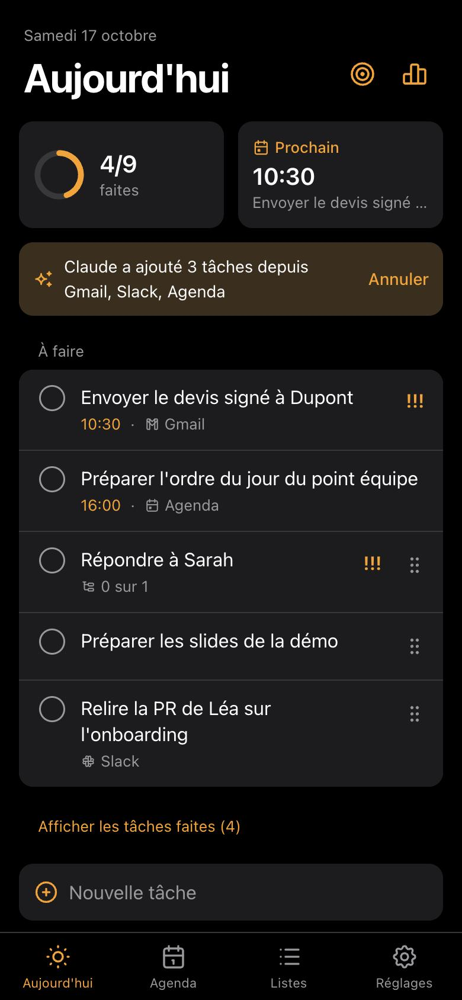
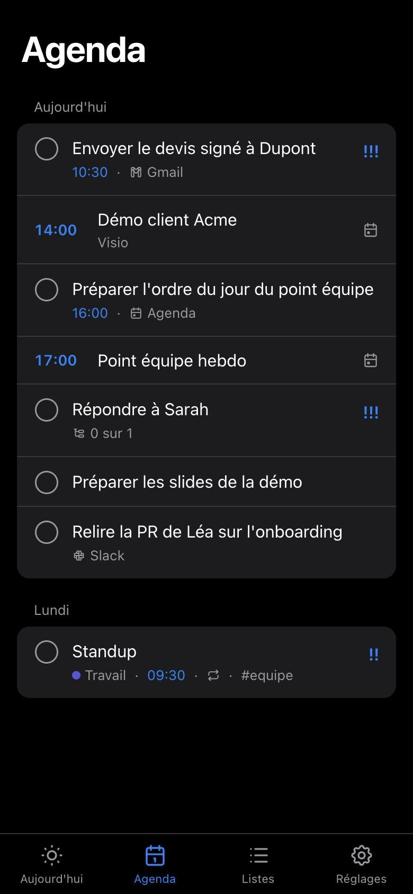
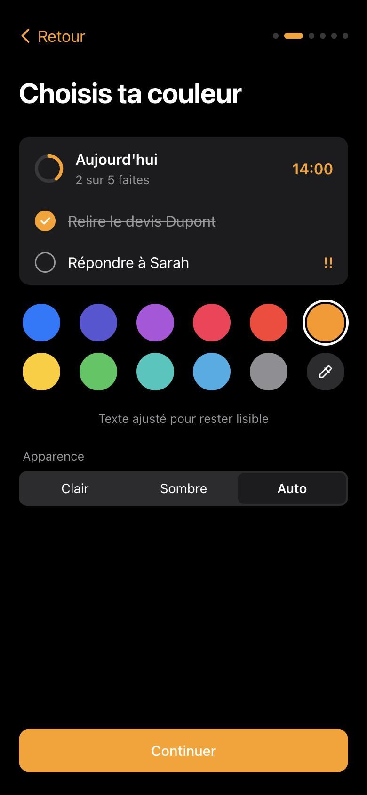
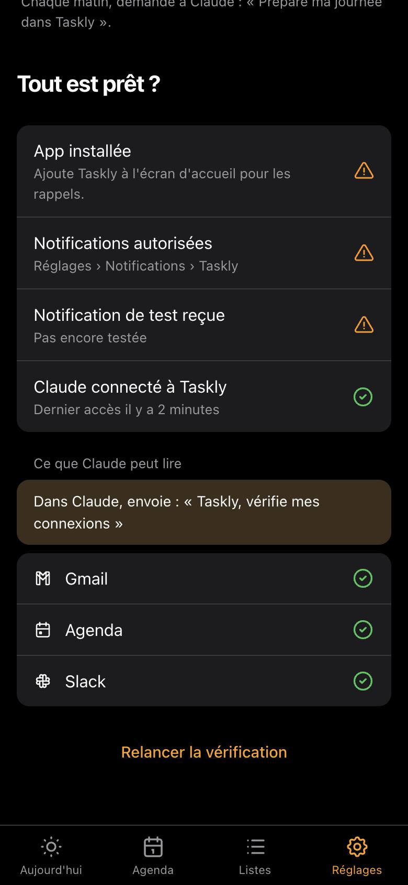
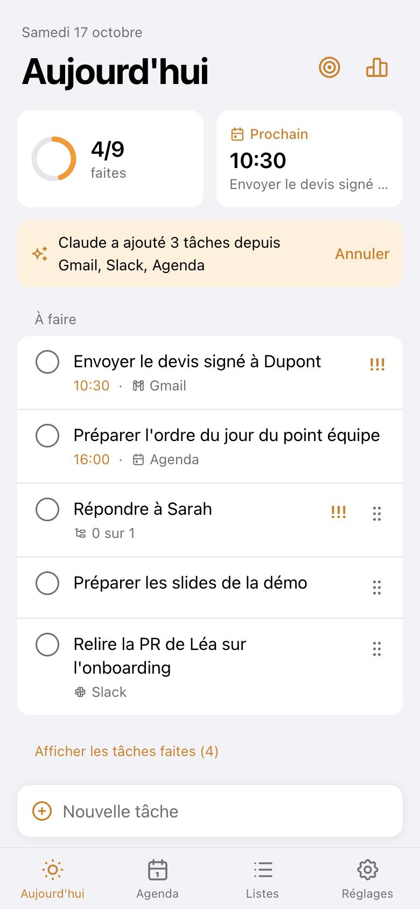
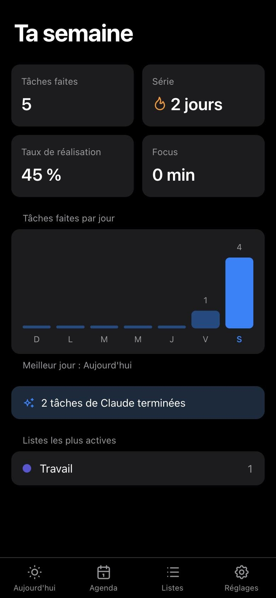
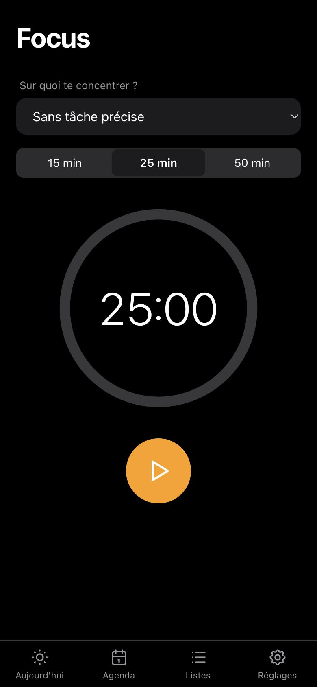
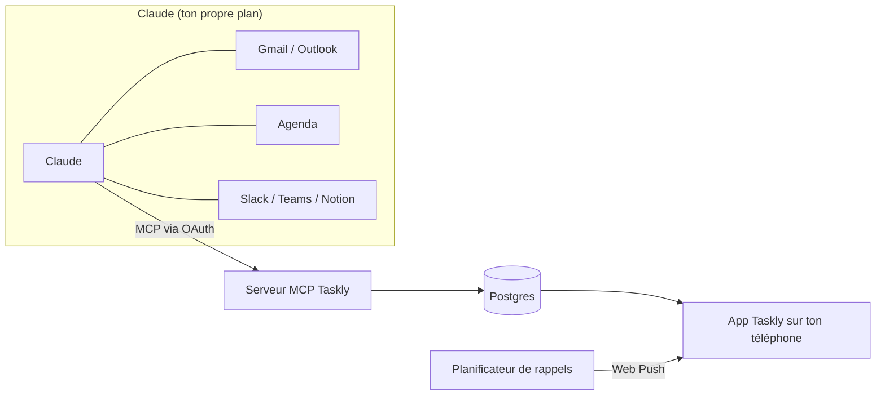

<div align="center">

<picture>
  <source media="(prefers-color-scheme: dark)" srcset="public/brand/taskly-logo-ivory.svg">
  
</picture>

**Ta journée, triée par Claude.**

Une todo list du jour open source, à installer sur ton téléphone.<br>
Claude lit tes mails, ton agenda et tes messages, les transforme en checklist,<br>
et Taskly s'assure que tu reçois vraiment tes rappels.

[English](README.md) · [Héberger](docs/self-hosting.md) · [Connecter Claude](docs/connect-claude.md) · [Feuille de route](#feuille-de-route) · [Contribuer](CONTRIBUTING.md)


</div>

<p align="center">
  
  
  
  
</p>

> [!NOTE]
> Taskly est en **bêta** : toutes les fonctions prévues sont là, testées et documentées, mais aucune instance publique ne l'a encore fait tourner longtemps. Les retours et les signalements de bugs sont bienvenus.

## ✨ Ce que fait Taskly

**Ta journée**
- ☀️ **Vue Aujourd'hui** : une seule checklist pour la journée, avec un anneau de progression et ton prochain rendez-vous
- 📅 **Agenda** : tes réunions et tes tâches datées des deux prochaines semaines, dans l'ordre de la journée
- ⌨️ **Saisie en langage naturel** : tape « Appeler Paul demain 14h !! » et la date, l'heure et la priorité sont réglées
- 🗂️ **Listes, tags, sous-tâches, priorités**, glisser-déposer, et **tâches récurrentes** (chaque jour, jours ouvrés, chaque semaine, chaque mois)

**Claude**
- 🤖 **Remplie par Claude** : demande « Prépare ma journée dans Taskly » et Claude transforme tes mails Gmail ou Outlook, tes agendas, Slack, Teams ou Notion en tâches, chacune avec un lien vers sa source
- ↩️ **Annulation en un geste** de ce que Claude vient d'ajouter, et les doublons sont ignorés
- 🩺 **Vérification** : tu vois d'un coup d'œil si l'app, les notifications et Claude sont vraiment connectés

**Rappels**
- 🔔 **De vrais rappels** : notifications à la minute près ; sur Android, « Fait » et « Plus tard » directement depuis la notification
- 🔁 **Relances** pour les tâches prioritaires, **heures calmes**, et un **badge** sur l'icône avec ce qu'il reste
- 🌅 **Briefing du matin** et 🌙 **bilan du soir**, avec report au lendemain en un geste

**Et aussi**
- 🎯 **Minuteur focus** et 📊 **stats de la semaine** (série, taux de réalisation, ce que Claude t'a aidé à faire)
- 👥 **Listes partagées** avec un lien d'invitation, et des tâches attribuées à quelqu'un
- 📴 **Hors-ligne** : ouvre ta journée et coche tes tâches sans connexion, tout se synchronise au retour
- 🎨 **Ta couleur d'accent**, mode clair ou sombre, avec un contraste ajusté automatiquement pour que le texte reste lisible
- 📱 **App installable** sur iPhone, Android, iPad et ordinateur (PWA)
- 🔐 **Pas de mot de passe** : Face ID / passkeys, ou un code à 6 chiffres reçu par email
- 🌍 **Français et anglais**
- 🔒 **Tes données t'appartiennent** : exporte tout en JSON ou supprime ton compte dans les Réglages

<details>
<summary>📸 Plus de captures</summary>
<p align="center">
  
  
  
</p>
</details>

## 🧠 Comment ça marche

Taskly n'appelle pas Claude et n'a pas besoin de clé API. C'est l'inverse : Taskly expose un serveur [MCP](https://modelcontextprotocol.io), tu l'ajoutes à Claude comme connecteur personnalisé, et Claude, qui lit déjà tes mails et ton agenda grâce à ses propres connecteurs, écrit les tâches dans Taskly.



Configuration et liste des outils que Claude peut utiliser : [docs/connect-claude.md](docs/connect-claude.md) (en anglais).

Ce que ce choix t'apporte :

- **Ton plan Claude actuel suffit.** Pas de clé API Anthropic, aucun coût à l'usage pour celui qui héberge Taskly.
- **Taskly ne reçoit jamais tes mails.** Il stocke seulement les tâches créées par Claude, avec un lien vers la source.
- **Taskly marche aussi sans Claude.** Tâches manuelles, rappels et checklist fonctionnent seuls.
- **Tu peux couper l'accès de Claude à tout moment.** **Réglages › Connecte Claude › Déconnecter Claude** le retire immédiatement, même pour les jetons pas encore expirés.

| Plan Claude | À savoir |
|---|---|
| Gratuit | Un seul connecteur personnalisé autorisé : ce sera Taskly. L'accès aux connecteurs mail et agenda peut être limité. |
| Pro / Max | Ajoute Taskly dans les réglages des connecteurs de Claude. |
| Team / Enterprise | Un propriétaire de l'organisation ajoute Taskly une fois dans les réglages de l'organisation. |

## 📱 Utiliser Taskly

1. Ouvre ton instance Taskly dans Safari (iPhone) ou Chrome (Android).
2. Installe-la : **Partager › Sur l'écran d'accueil** sur iPhone, **Installer** sur Android et ordinateur.
3. Ouvre Taskly depuis l'écran d'accueil et suis l'onboarding : compte, couleur, notifications, Claude, puis une vérification que tout est connecté.

> [!NOTE]
> Sur iPhone, les notifications ne marchent qu'une fois Taskly installé sur l'écran d'accueil (iOS 16.4 minimum).

## 🚀 Héberger sa propre instance

[](https://vercel.com/new/clone?repository-url=https%3A%2F%2Fgithub.com%2Fethanfrq%2FTaskly&project-name=taskly&repository-name=taskly&env=BETTER_AUTH_SECRET,RESEND_API_KEY,EMAIL_FROM,NEXT_PUBLIC_VAPID_PUBLIC_KEY,VAPID_PRIVATE_KEY,VAPID_SUBJECT&envDescription=Secrets%20for%20sign-in%2C%20email%20codes%20and%20push%20notifications.&envLink=https%3A%2F%2Fgithub.com%2Fethanfrq%2FTaskly%2Fblob%2Fmain%2Fdocs%2Fself-hosting.md%23environment-variables&stores=%5B%7B%22type%22%3A%22integration%22%2C%22integrationSlug%22%3A%22neon%22%2C%22productSlug%22%3A%22neon%22%2C%22protocol%22%3A%22storage%22%7D%5D)

Il te faut une base Postgres (Neon, proposée par le bouton), une clé [Resend](https://resend.com) pour les codes de connexion, des clés VAPID pour les notifications, et un planificateur pour les rappels (Upstash QStash sur Vercel, ou le serveur lui-même sur un VPS). Le guide pas à pas, toutes les variables d'environnement et un tableau de dépannage sont dans **[docs/self-hosting.md](docs/self-hosting.md)** (en anglais).

> [!IMPORTANT]
> Le plan Hobby de Vercel est réservé à un usage personnel et non commercial. Pour héberger Taskly pour une entreprise, utilise une équipe Pro.

## 💻 Développer en local

```bash
git clone https://github.com/ethanfrq/Taskly.git && cd Taskly
```

```bash
npm install
```

```bash
npm run dev
```

Aucune configuration : une base locale est créée dans `.data/`, les codes de connexion s'affichent dans le terminal et les clés de notification sont générées. Ouvre http://localhost:3000.

```bash
npm run lint && npm run typecheck && npm test
```

<a id="feuille-de-route"></a>

## 🗺️ Feuille de route

| Étape | Contenu | Statut |
|---|---|---|
| **v0.1 Base** | PWA installable, compte (passkey + code par email), onboarding, checklist Aujourd'hui, listes et tags, sous-tâches, priorités, glisser-déposer, saisie en langage naturel, export des données et suppression du compte | ✅ [#8](https://github.com/ethanfrq/Taskly/pull/8) [#9](https://github.com/ethanfrq/Taskly/pull/9) [#10](https://github.com/ethanfrq/Taskly/pull/10) [#11](https://github.com/ethanfrq/Taskly/pull/11) [#12](https://github.com/ethanfrq/Taskly/pull/12) [#13](https://github.com/ethanfrq/Taskly/pull/13) [#15](https://github.com/ethanfrq/Taskly/pull/15) |
| **v0.2 Claude** | Serveur MCP avec OAuth, connexion à Claude et vérification, timeline de l'agenda | ✅ [#17](https://github.com/ethanfrq/Taskly/pull/17) [#20](https://github.com/ethanfrq/Taskly/pull/20) |
| **v0.3 Rappels** | Notifications push, rappels à l'heure, relances, reporter, heures calmes, badge, briefing du matin, bilan du soir et report, tâches récurrentes | ✅ [#13](https://github.com/ethanfrq/Taskly/pull/13) [#14](https://github.com/ethanfrq/Taskly/pull/14) |
| **v0.4 Confort** | Mode focus / Pomodoro, stats de la semaine, mode hors-ligne | ✅ [#16](https://github.com/ethanfrq/Taskly/pull/16) [#18](https://github.com/ethanfrq/Taskly/pull/18) |
| **v0.5 Partage** | Listes partagées | ✅ [#19](https://github.com/ethanfrq/Taskly/pull/19) |

Les idées et les bugs sont bienvenus dans les [issues](https://github.com/ethanfrq/Taskly/issues). Chaque modification arrive dans sa propre petite pull request.

## 🛠️ Technologies

- [Next.js](https://nextjs.org) 16 (React 19, TypeScript), Tailwind CSS 4
- Postgres avec [Drizzle ORM](https://orm.drizzle.team) : Neon en production, [PGlite](https://pglite.dev) en local et dans les tests
- [Better Auth](https://www.better-auth.com) : passkeys, codes par email, et le serveur OAuth 2.1 par lequel Claude se connecte
- Le [SDK MCP TypeScript](https://github.com/modelcontextprotocol/typescript-sdk) officiel
- Web Push avec un service worker, planifié par [Upstash QStash](https://upstash.com/docs/qstash) ou par le serveur lui-même
- [Vitest](https://vitest.dev) pour les tests

Chaque choix et ses compromis sont expliqués dans [docs/adr](docs/adr/README.md) (en anglais).

## 🎨 Design

Tout le parcours iPhone existe sous forme de [prototype cliquable](https://htmlpreview.github.io/?https://github.com/ethanfrq/Taskly/blob/main/docs/design/prototype.html), de la page web au bilan du soir. Chaque choix de design et sa raison sont dans [docs/design](docs/design/README.md) (en anglais).

## 🤝 Contribuer

Les contributions sont les bienvenues. Lis d'abord [CONTRIBUTING.md](CONTRIBUTING.md) (en anglais) : chaque modification passe par sa propre pull request avec une description claire, et la CI doit être verte avant le merge.

Merci de respecter le [code de conduite](CODE_OF_CONDUCT.md).

## 🔒 Confidentialité et sécurité

- Taskly stocke des tâches, jamais le contenu de tes mails.
- Tu peux exporter ou supprimer toutes tes données à tout moment, dans les Réglages.
- Claude n'obtient que les accès que tu acceptes sur l'écran de consentement de Taskly.
- Signale les failles de sécurité en privé, voir [SECURITY.md](SECURITY.md).

## ⚖️ Licence

[MIT](LICENSE)

---

Taskly est un projet open source indépendant. Il n'est ni affilié, ni approuvé, ni sponsorisé par Anthropic. Claude est une marque d'Anthropic.
