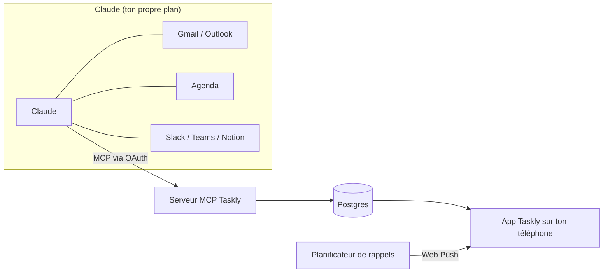

<div align="center">

<picture>
  <source media="(prefers-color-scheme: dark)" srcset="public/brand/taskly-logo-ivory.svg">
  
</picture>

### Ta journée, triée par Claude.

Une todo list du jour open source, à installer sur ton téléphone.<br>
Claude transforme tes mails, ton agenda et tes messages en checklist, et Taskly s'assure que tu reçois tes rappels.

[](https://github.com/ethanfrq/Taskly/releases)
[](LICENSE)


**[Démarrage rapide](#demarrage-rapide)** · [Héberger](docs/self-hosting.md) · [Connecter Claude](docs/connect-claude.md) · [Contribuer](CONTRIBUTING.md) · [English](README.md)

<br>

&nbsp;
&nbsp;
&nbsp;


<sub>Aujourd'hui · Agenda · Onboarding · Vérification</sub>

</div>

> [!NOTE]
> **Bêta.** Toutes les fonctions prévues sont là, testées et documentées, mais aucune instance publique n'a encore fait tourner Taskly longtemps. [Les retours sont bienvenus](https://github.com/ethanfrq/Taskly/issues).

## Sommaire

- [Points forts](#points-forts)
- [Démarrage rapide](#demarrage-rapide) : [installer](#installer) · [connecter Claude](#connecter-claude)
- [Comment ça marche](#fonctionnement)
- [Héberger sa propre instance](#hebergement)
- [Développer](#developpement)
- [Confidentialité et sécurité](#confidentialite)
- [État du projet](#etat)
- [Contribuer](#contribuer)

<a id="points-forts"></a>

## ✨ Points forts

- 🤖 **Remplie par Claude.** Dis « Prépare ma journée dans Taskly » : Claude transforme tes mails Gmail ou Outlook, tes agendas, Slack, Teams ou Notion en tâches, chacune reliée à sa source.
- 🔔 **Des rappels qui sonnent vraiment.** Notifications à la minute près, relances pour ce qui compte, heures calmes, briefing du matin et bilan du soir.
- ☀️ **Une journée claire.** Une checklist Aujourd'hui avec anneau de progression et prochain rendez-vous, plus un agenda sur deux semaines.
- ⌨️ **Écris comme tu parles.** « Appeler Paul demain 14h !! » règle la date, l'heure et la priorité.
- 📱 **Une app, pas un site.** S'installe sur iPhone, Android et ordinateur, et marche hors-ligne.
- 🔐 **Privée par conception.** Pas de mot de passe, pas de clé API, jamais tes mails : seulement les tâches.

<details>
<summary><b>Toutes les fonctionnalités</b></summary>

<br>

| | |
|---|---|
| **Tâches** | Listes, tags, sous-tâches, priorités, glisser-déposer, tâches récurrentes (chaque jour, jours ouvrés, chaque semaine, chaque mois), saisie en langage naturel |
| **Ta journée** | Vue Aujourd'hui avec anneau de progression et prochain rendez-vous, agenda sur deux semaines dans l'ordre, report au lendemain |
| **Claude** | Connecteur MCP avec OAuth, annulation en un geste de ce que Claude a ajouté, doublons ignorés, réunions annulées retirées, vérification, déconnexion en un geste |
| **Rappels** | Web Push à la minute près, relances des tâches prioritaires, reporter, heures calmes, badge sur l'icône, briefing du matin, bilan du soir ; « Fait » et « Plus tard » depuis la notification sur Android |
| **Focus** | Minuteur focus (15, 25 ou 50 min), stats de la semaine : série, taux de réalisation, ce que Claude t'a aidé à faire |
| **Partage** | Listes partagées avec un lien d'invitation, tâches attribuées à quelqu'un |
| **App** | PWA installable, mode hors-ligne avec synchronisation, ta couleur d'accent, mode clair et sombre avec contraste automatique, français et anglais |
| **Compte** | Passkeys (Face ID, Touch ID) ou code à 6 chiffres par email, export des données en JSON, suppression du compte |

</details>

<details>
<summary><b>Plus de captures</b></summary>

<br>

<p align="center">
  &nbsp;
  &nbsp;
  
</p>

</details>

<a id="demarrage-rapide"></a>

## 🚀 Démarrage rapide

| Je veux… | Aller à |
|---|---|
| Utiliser Taskly sur mon téléphone | [L'installer](#installer), puis [connecter Claude](#connecter-claude) |
| Héberger Taskly pour moi ou mon équipe | [Héberger sa propre instance](#hebergement) |
| Travailler sur le code | [Développer](#developpement) |

<a id="installer"></a>

### 📱 L'installer

1. Ouvre ton instance Taskly dans **Safari** (iPhone) ou **Chrome** (Android, ordinateur).
2. Installe-la : **Partager › Sur l'écran d'accueil** sur iPhone, **Installer l'application** sur Android et ordinateur.
3. Ouvre Taskly depuis l'écran d'accueil et suis l'onboarding : compte, couleur, notifications, Claude, puis une vérification finale que tout marche.

> [!IMPORTANT]
> Sur iPhone, les notifications ne marchent qu'une fois Taskly sur l'écran d'accueil (iOS 16.4 minimum).

<a id="connecter-claude"></a>

### 🤖 Connecter Claude

1. Dans Taskly, ouvre **Réglages › Connecte Claude** et copie l'adresse du connecteur.
2. Dans Claude, ajoute-la comme **connecteur personnalisé** et connecte-toi à Taskly pour autoriser l'accès.
3. Chaque matin, demande à Claude : **« Prépare ma journée dans Taskly »**.

| Plan Claude | À savoir |
|---|---|
| Gratuit | Un seul connecteur personnalisé autorisé : ce sera Taskly. L'accès aux connecteurs mail et agenda peut être limité. |
| Pro / Max | Ajoute Taskly dans les réglages des connecteurs de Claude. |
| Team / Enterprise | Un propriétaire de l'organisation ajoute Taskly une fois pour tout le monde. |

Les outils que Claude reçoit et le modèle de sécurité : [docs/connect-claude.md](docs/connect-claude.md) (en anglais).

<a id="fonctionnement"></a>

## 🧠 Comment ça marche

Taskly n'appelle pas Claude. C'est l'inverse : Taskly expose un serveur [MCP](https://modelcontextprotocol.io), et Claude, qui lit déjà tes mails et ton agenda grâce à ses propres connecteurs, écrit les tâches dans Taskly.



- **Ton plan Claude suffit.** Pas de clé API Anthropic, aucun coût d'IA pour celui qui héberge Taskly.
- **Taskly ne reçoit jamais tes mails.** Seulement les tâches créées par Claude, avec un lien vers la source.
- **Taskly marche aussi sans Claude.** Tâches manuelles, rappels et checklist fonctionnent seuls.

<a id="hebergement"></a>

## ☁️ Héberger sa propre instance

[](https://vercel.com/new/clone?repository-url=https%3A%2F%2Fgithub.com%2Fethanfrq%2FTaskly&project-name=taskly&repository-name=taskly&env=BETTER_AUTH_SECRET,RESEND_API_KEY,EMAIL_FROM,NEXT_PUBLIC_VAPID_PUBLIC_KEY,VAPID_PRIVATE_KEY,VAPID_SUBJECT&envDescription=Secrets%20for%20sign-in%2C%20email%20codes%20and%20push%20notifications.&envLink=https%3A%2F%2Fgithub.com%2Fethanfrq%2FTaskly%2Fblob%2Fmain%2Fdocs%2Fself-hosting.md%23environment-variables&stores=%5B%7B%22type%22%3A%22integration%22%2C%22integrationSlug%22%3A%22neon%22%2C%22productSlug%22%3A%22neon%22%2C%22protocol%22%3A%22storage%22%7D%5D)

| Il te faut | Pour | Sur Vercel |
|---|---|---|
| Postgres | Comptes, tâches, rappels | Neon, proposé par le bouton |
| [Resend](https://resend.com) | Codes de connexion par email | Clé API |
| Clés VAPID | Notifications push | `npx web-push generate-vapid-keys` |
| Un planificateur | Rappels à la minute près | Upstash QStash, depuis le Marketplace |

Le pas à pas pour Vercel ou ton propre serveur, toutes les variables d'environnement et un tableau de dépannage : **[docs/self-hosting.md](docs/self-hosting.md)** (en anglais).

> [!WARNING]
> Le plan Hobby de Vercel est réservé à un usage personnel et non commercial. Pour héberger Taskly pour une entreprise, utilise une équipe Pro.

<a id="developpement"></a>

## 💻 Développer

```bash
git clone https://github.com/ethanfrq/Taskly.git && cd Taskly
```

```bash
npm install
```

```bash
npm run dev
```

Ouvre http://localhost:3000. Rien à configurer : la base locale vit dans `.data/`, les codes de connexion s'affichent dans le terminal et les clés de notification sont générées pour toi. Avant de pousser :

```bash
npm run lint && npm run typecheck && npm test
```

Toutes les commandes et les conventions de branches et de commits sont dans [CONTRIBUTING.md](CONTRIBUTING.md) (en anglais).

**Technologies :** [Next.js](https://nextjs.org) 16 (React 19, TypeScript) · Tailwind CSS 4 · Postgres avec [Drizzle](https://orm.drizzle.team) ([PGlite](https://pglite.dev) en local) · [Better Auth](https://www.better-auth.com) (passkeys, codes par email, OAuth 2.1) · [SDK MCP TypeScript](https://github.com/modelcontextprotocol/typescript-sdk) · Web Push avec [Upstash QStash](https://upstash.com/docs/qstash) · [Vitest](https://vitest.dev). Le pourquoi de chaque choix : [docs/adr](docs/adr/README.md) (en anglais).

<a id="confidentialite"></a>

## 🔒 Confidentialité et sécurité

- **Des tâches, pas des mails.** Taskly stocke les tâches créées par Claude et un lien vers leur source, jamais le contenu de tes messages.
- **Tu choisis ce que Claude obtient** sur l'écran de consentement de Taskly, et **Réglages › Connecte Claude › Déconnecter Claude** le retire immédiatement, même pour les jetons pas encore expirés.
- **Tes données t'appartiennent.** Exporte tout en JSON ou supprime ton compte dans les Réglages.
- **Une faille ?** Signale-la en privé, voir [SECURITY.md](SECURITY.md).

<a id="etat"></a>

## 🗺️ État du projet

Les cinq étapes sont livrées : **v0.1** Base · **v0.2** Claude · **v0.3** Rappels · **v0.4** Confort · **v0.5** Partage. Ce que chacune a apporté, avec les pull requests correspondantes, est dans les [notes de la version 0.5.0](https://github.com/ethanfrq/Taskly/releases/tag/v0.5.0) et les [jalons](https://github.com/ethanfrq/Taskly/milestones?state=closed).

La suite : l'usage réel. Les idées et les bugs vont dans les [issues](https://github.com/ethanfrq/Taskly/issues).

<a id="contribuer"></a>

## 🤝 Contribuer

Les contributions sont les bienvenues, une petite pull request à la fois. Commence par [CONTRIBUTING.md](CONTRIBUTING.md) et le [code de conduite](CODE_OF_CONDUCT.md).

Le design est documenté aussi : un [prototype cliquable](https://htmlpreview.github.io/?https://github.com/ethanfrq/Taskly/blob/main/docs/design/prototype.html) de tout le parcours iPhone et chaque décision de design dans [docs/design](docs/design/README.md) (en anglais).

## ⚖️ Licence

[MIT](LICENSE). Taskly est un projet open source indépendant, ni affilié, ni approuvé, ni sponsorisé par Anthropic. Claude est une marque d'Anthropic.
