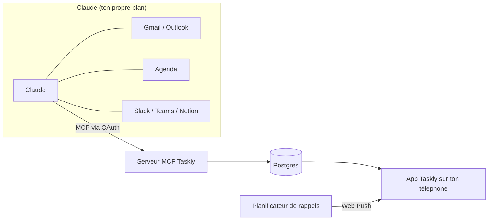

# ✅ Taskly

**Ta journée, triée par Claude.**

Une todo list du jour open source, à installer sur ton téléphone. 
Claude lit tes mails, ton agenda et tes messages, les transforme en checklist, 
et Taskly s'assure que tu reçois vraiment tes rappels.

[English](README.md) · [Feuille de route](#feuille-de-route) · [Contribuer](CONTRIBUTING.md) · [Sécurité](SECURITY.md)

> [!WARNING]
> Taskly est en tout début de développement et pas encore utilisable. Suis la [feuille de route](#feuille-de-route) pour voir ce qui arrive.

## ✨ Ce que fait Taskly

- ☀️ **Vue Aujourd'hui** : une seule checklist pour la journée, avec ton prochain rendez-vous et un anneau de progression
- 🤖 **Remplie par Claude** : Claude lit Gmail, Outlook, Google Agenda, Slack, Teams ou Notion grâce à ses propres connecteurs et ajoute les tâches dans Taskly
- 🔔 **De vrais rappels** : notifications à la minute près, relances pour les tâches prioritaires, heures calmes et badge sur l'icône
- 🌅 **Briefing du matin** et 🌙 **bilan du soir**, avec report au lendemain en un geste
- ⌨️ **Saisie en langage naturel** : tape « Appeler Paul demain 14h », c'est tout
- 🎨 **Ta couleur d'accent**, mode clair ou sombre, avec un contraste ajusté automatiquement pour que le texte reste lisible
- 📱 **App installable** sur iPhone, Android, iPad et ordinateur (PWA)
- 🔐 **Pas de mot de passe** : Face ID / passkeys, ou un code à 6 chiffres reçu par email
- 🌍 **Français et anglais**

## 🧠 Comment ça marche

Taskly n'appelle pas Claude et n'a pas besoin de clé API. C'est l'inverse : Taskly expose un serveur [MCP](https://modelcontextprotocol.io), tu l'ajoutes à Claude comme connecteur personnalisé, et Claude, qui lit déjà tes mails et ton agenda grâce à ses propres connecteurs, écrit les tâches dans Taskly.

Ce que ce choix t'apporte :

- **Ton plan Claude actuel suffit.** Pas de clé API Anthropic, aucun coût à l'usage pour celui qui héberge Taskly.
- **Taskly ne reçoit jamais tes mails.** Il stocke seulement les tâches créées par Claude, avec un lien vers la source.
- **Taskly marche aussi sans Claude.** Tâches manuelles, rappels et checklist fonctionnent seuls.

| Plan Claude | À savoir |
|---|---|
| Gratuit | Un seul connecteur personnalisé autorisé : ce sera Taskly. L'accès aux connecteurs mail et agenda peut être limité. |
| Pro / Max | Ajoute Taskly dans les réglages des connecteurs de Claude. |
| Team / Enterprise | Un propriétaire de l'organisation ajoute Taskly une fois dans les réglages de l'organisation. |

## 📱 Utiliser Taskly

> Disponible à partir de la v0.1.

1. Ouvre ton instance Taskly dans Safari (iPhone) ou Chrome (Android).
2. Installe-la : **Partager › Sur l'écran d'accueil** sur iPhone, **Installer** sur Android et ordinateur.
3. Ouvre Taskly depuis l'écran d'accueil et suis l'onboarding : compte, couleur, notifications, Claude, puis une vérification que tout est connecté.

> [!NOTE]
> Sur iPhone, les notifications ne marchent qu'une fois Taskly installé sur l'écran d'accueil (iOS 16.4 minimum).

## 🚀 Héberger sa propre instance

> Un bouton **Deploy to Vercel** arrive avec la v0.1, une fois la base de données, l'authentification et les notifications en place.

Prérequis prévus :

- Un compte [Vercel](https://vercel.com)
- Une base Postgres ([Neon](https://neon.tech) via le Marketplace Vercel)
- [Upstash QStash](https://upstash.com/docs/qstash) pour envoyer les rappels à la minute près
- Des clés VAPID pour les notifications Web Push
- Un service d'envoi d'emails pour les codes de connexion

> [!IMPORTANT]
> Le plan Hobby de Vercel est réservé à un usage personnel et non commercial. Pour héberger Taskly pour une entreprise, utilise une équipe Pro.

## 🗺️ Feuille de route

| Étape | Contenu | Statut |
|---|---|---|
| **v0.1 Base** | PWA installable, compte (passkey + code par email), onboarding, checklist Aujourd'hui, listes et tags, sous-tâches, priorités, glisser-déposer, saisie en langage naturel, export des données et suppression du compte | 🔜 Prochaine |
| **v0.2 Claude** | Serveur MCP avec OAuth, connexion à Claude et vérification, timeline de l'agenda | Prévue |
| **v0.3 Rappels** | Notifications push, rappels à l'heure, relances, reporter, heures calmes, badge, briefing du matin, bilan du soir et report, tâches récurrentes | Prévue |
| **v0.4 Confort** | Mode focus / Pomodoro, stats de la semaine, mode hors-ligne | Prévue |
| **v0.5 Partage** | Listes partagées | Prévue |

Chaque étape arrive en une série de petites pull requests. L'avancement est visible dans les [milestones](https://github.com/ethanfrq/Taskly/milestones).

## 🛠️ Technologies

En place : [Next.js](https://nextjs.org) (React, TypeScript), Tailwind CSS, Vitest.

Prévues : Neon Postgres avec Drizzle ORM, Better Auth (passkeys et codes par email), un serveur MCP avec OAuth, Web Push avec Upstash QStash, hébergé sur Vercel.

Chaque choix et ses compromis sont expliqués dans [docs/adr](docs/adr/README.md) (en anglais).

## 🎨 Design

Tout le parcours iPhone existe sous forme de [prototype cliquable](https://htmlpreview.github.io/?https://github.com/ethanfrq/Taskly/blob/main/docs/design/prototype.html), de la page web au bilan du soir. Chaque choix de design et sa raison sont dans [docs/design](docs/design/README.md) (en anglais).

## 🤝 Contribuer

Les contributions sont les bienvenues. Lis d'abord [CONTRIBUTING.md](CONTRIBUTING.md) (en anglais) : chaque modification passe par sa propre pull request avec une description claire, et la CI doit être verte avant le merge.

Merci de respecter le [code de conduite](CODE_OF_CONDUCT.md).

## 🔒 Confidentialité et sécurité

- Taskly stocke des tâches, jamais le contenu de tes mails.
- Tu peux exporter ou supprimer toutes tes données à tout moment (v0.1).
- Signale les failles de sécurité en privé, voir [SECURITY.md](SECURITY.md).

## ⚖️ Licence

[MIT](LICENSE)

---

Taskly est un projet open source indépendant. Il n'est ni affilié, ni approuvé, ni sponsorisé par Anthropic. Claude est une marque d'Anthropic.
