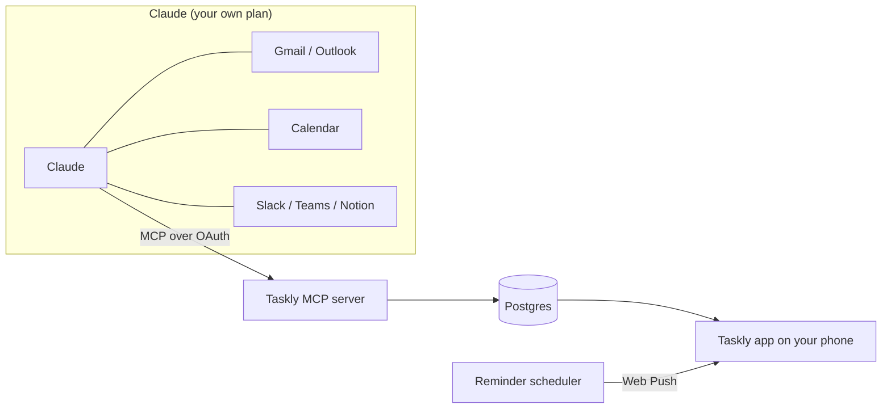

<picture>
  <source media="(prefers-color-scheme: dark)" srcset="public/brand/taskly-logo-ivory.svg">
  
</picture>

**Your day, sorted by Claude.**

An open-source daily to-do app you install on your phone. 
Claude reads your mail, calendar and messages, turns them into a checklist, 
and Taskly makes sure you actually get reminded.

[Français](README.fr.md) · [Roadmap](#roadmap) · [Contributing](CONTRIBUTING.md) · [Security](SECURITY.md)

> [!WARNING]
> Taskly is in early development and not usable yet. Follow the [roadmap](#roadmap) to see what's coming.

## ✨ What it does

- ☀️ **Today view** — one checklist for the day, with your next meeting and a progress ring
- 🤖 **Filled by Claude** — Claude reads Gmail, Outlook, Google Calendar, Slack, Teams or Notion through its own connectors and adds the tasks to Taskly
- 🔔 **Real reminders** — push notifications at the right minute, follow-ups for priority tasks, quiet hours and an app badge
- 🌅 **Morning briefing** and 🌙 **evening review**, with one-tap carry-over to tomorrow
- ⌨️ **Natural language input** — type "Call Paul tomorrow 2pm" and you're done
- 🎨 **Your accent color**, light or dark mode, with automatic contrast so text always stays readable
- 📱 **Installable app** on iPhone, Android, iPad and desktop (PWA)
- 🔐 **No password** — Face ID / passkeys, or a 6-digit code sent by email
- 🌍 **French and English**

## 🧠 How it works

Taskly doesn't call Claude and doesn't need an API key. It works the other way around: Taskly exposes an [MCP](https://modelcontextprotocol.io) server, you add it to Claude as a custom connector, and Claude, which already reads your mail and calendar through its own connectors, writes tasks into Taskly.

Setup and the list of tools Claude can use: [docs/connect-claude.md](docs/connect-claude.md).

What this design gives you:

- **Your existing Claude plan is enough.** No Anthropic API key, no per-use cost for whoever hosts Taskly.
- **Taskly never receives your emails.** It only stores the tasks Claude creates, with a link back to the source.
- **Taskly works without Claude.** Manual tasks, reminders and the checklist are fully usable on their own.

| Claude plan | What to know |
|---|---|
| Free | One custom connector allowed, so Taskly can be it. Access to the mail and calendar connectors may be limited. |
| Pro / Max | Add Taskly in Claude's connector settings. |
| Team / Enterprise | An organization owner adds Taskly once in the organization settings. |

## 📱 Using Taskly

> Available from v0.1.

1. Open your Taskly instance in Safari (iPhone) or Chrome (Android).
2. Install it: **Share › Add to Home Screen** on iPhone, **Install** on Android and desktop.
3. Open Taskly from your home screen and follow the onboarding: account, color, notifications, Claude, then a check that everything is connected.

> [!NOTE]
> On iPhone, notifications only work once Taskly is installed on the home screen (iOS 16.4 or later).

## 🚀 Self-hosting

> A one-click **Deploy to Vercel** button lands with v0.1, once the database, auth and push setup exist.

Planned requirements:

- A [Vercel](https://vercel.com) account
- A Postgres database ([Neon](https://neon.tech) through the Vercel Marketplace)
- [Upstash QStash](https://upstash.com/docs/qstash) to send reminders at the exact minute
- VAPID keys for Web Push
- An email provider for login codes

> [!IMPORTANT]
> Vercel's Hobby plan is for personal, non-commercial use. If you host Taskly for a company, use a Pro team.

## 🗺️ Roadmap

| Milestone | Scope | Status |
|---|---|---|
| **v0.1 Core** | Installable PWA, account (passkey + email code), onboarding, Today checklist, lists and tags, subtasks, priorities, drag to reorder, natural language input, data export and account deletion | 🔜 Next |
| **v0.2 Claude** | MCP server with OAuth, Claude connection and health check, calendar timeline | Planned |
| **v0.3 Reminders** | Push notifications, exact-time reminders, follow-ups, snooze, quiet hours, app badge, morning briefing, evening review and carry-over, recurring tasks | Planned |
| **v0.4 Comfort** | Focus mode / Pomodoro, weekly stats, offline mode | Planned |
| **v0.5 Sharing** | Shared lists | Planned |

Each milestone ships as a series of small pull requests. See the [milestones](https://github.com/ethanfrq/Taskly/milestones) for progress.

## 🛠️ Tech stack

In place: [Next.js](https://nextjs.org) (React, TypeScript), Tailwind CSS, Vitest.

Planned: Neon Postgres with Drizzle ORM, Better Auth (passkeys and email codes), an MCP server with OAuth, Web Push with Upstash QStash, hosted on Vercel.

Each choice and its trade-offs are recorded in [docs/adr](docs/adr/README.md).

## 🎨 Design

The full iPhone flow is mocked up as a [clickable prototype](https://htmlpreview.github.io/?https://github.com/ethanfrq/Taskly/blob/main/docs/design/prototype.html), from the web page to the evening review. Every design choice and its reason is in [docs/design](docs/design/README.md).

## 🤝 Contributing

Contributions are welcome. Read [CONTRIBUTING.md](CONTRIBUTING.md) first: every change goes through its own pull request with a clear description, and CI must be green before merging.

Please follow the [Code of Conduct](CODE_OF_CONDUCT.md).

## 🔒 Privacy and security

- Taskly stores tasks, not email content.
- You can export or delete all your data at any time (v0.1).
- Report vulnerabilities privately, see [SECURITY.md](SECURITY.md).

## ⚖️ License

[MIT](LICENSE)

---

Taskly is an independent open-source project. It is not affiliated with, endorsed by or sponsored by Anthropic. Claude is a trademark of Anthropic.
