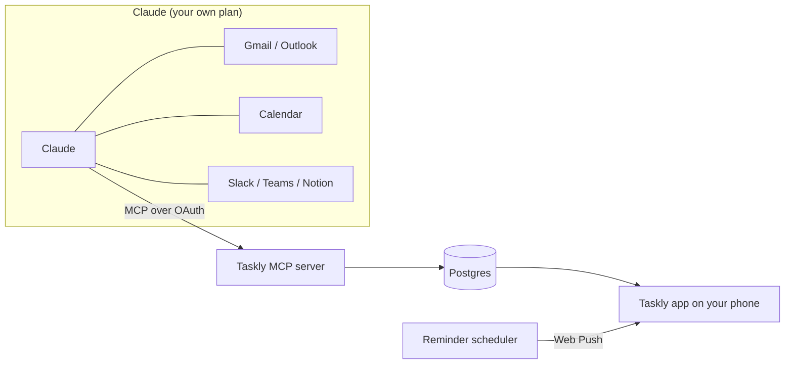

<div align="center">

<picture>
  <source media="(prefers-color-scheme: dark)" srcset="public/brand/taskly-logo-ivory.svg">
  
</picture>

**Your day, sorted by Claude.**

An open-source daily to-do app you install on your phone.<br>
Claude reads your mail, calendar and messages, turns them into a checklist,<br>
and Taskly makes sure you actually get reminded.

[Français](README.fr.md) · [Self-hosting](docs/self-hosting.md) · [Connect Claude](docs/connect-claude.md) · [Roadmap](#roadmap) · [Contributing](CONTRIBUTING.md)


</div>

<p align="center">
  
  
  
  
</p>

> [!NOTE]
> Taskly is in **beta**: every planned feature is in, tested and documented, but no public instance has run it for long yet. Feedback and bug reports are welcome.

## ✨ What it does

**Your day**
- ☀️ **Today view**: one checklist for the day, with a progress ring and your next appointment
- 📅 **Agenda**: your meetings and dated tasks for the next two weeks, in time order
- ⌨️ **Natural language input**: type "Call Paul tomorrow 2pm !!" and the date, time and priority are set
- 🗂️ **Lists, tags, subtasks, priorities**, drag to reorder, and **recurring tasks** (daily, weekdays, weekly, monthly)

**Claude**
- 🤖 **Filled by Claude**: ask "Prepare my day in Taskly" and Claude turns your Gmail, Outlook, calendars, Slack, Teams or Notion into tasks, each with a link back to its source
- ↩️ **One-tap undo** of what Claude just added, and duplicates are skipped
- 🩺 **Health check**: see at a glance whether the app, notifications and Claude are really connected

**Reminders**
- 🔔 **Real reminders**: push notifications at the right minute; on Android, "Done" and "Later" right from the notification
- 🔁 **Follow-ups** for priority tasks, **quiet hours**, and an **app badge** with what's left
- 🌅 **Morning briefing** and 🌙 **evening review**, with one-tap carry-over to tomorrow

**And also**
- 🎯 **Focus timer** and 📊 **weekly stats** (streak, completion rate, what Claude helped with)
- 👥 **Shared lists** with an invite link, and tasks assigned to someone
- 📴 **Works offline**: open your day and check tasks without a connection, synced when you're back
- 🎨 **Your accent color**, light or dark mode, with automatic contrast so text stays readable
- 📱 **Installable app** on iPhone, Android, iPad and desktop (PWA)
- 🔐 **No password**: Face ID / passkeys, or a 6-digit code sent by email
- 🌍 **French and English**
- 🔒 **Your data is yours**: export everything as JSON or delete your account in Settings

<details>
<summary>📸 More screenshots</summary>
<p align="center">
  
  
  
</p>
</details>

## 🧠 How it works

Taskly doesn't call Claude and doesn't need an API key. It works the other way around: Taskly exposes an [MCP](https://modelcontextprotocol.io) server, you add it to Claude as a custom connector, and Claude, which already reads your mail and calendar through its own connectors, writes tasks into Taskly.



Setup and the list of tools Claude can use: [docs/connect-claude.md](docs/connect-claude.md).

What this design gives you:

- **Your existing Claude plan is enough.** No Anthropic API key, no per-use cost for whoever hosts Taskly.
- **Taskly never receives your emails.** It only stores the tasks Claude creates, with a link back to the source.
- **Taskly works without Claude.** Manual tasks, reminders and the checklist are fully usable on their own.
- **You can cut Claude off at any time.** **Settings › Connect Claude › Disconnect Claude** revokes its access at once, even tokens that haven't expired yet.

| Claude plan | What to know |
|---|---|
| Free | One custom connector allowed, so Taskly can be it. Access to the mail and calendar connectors may be limited. |
| Pro / Max | Add Taskly in Claude's connector settings. |
| Team / Enterprise | An organization owner adds Taskly once in the organization settings. |

## 📱 Using Taskly

1. Open your Taskly instance in Safari (iPhone) or Chrome (Android).
2. Install it: **Share › Add to Home Screen** on iPhone, **Install** on Android and desktop.
3. Open Taskly from your home screen and follow the onboarding: account, color, notifications, Claude, then a check that everything is connected.

> [!NOTE]
> On iPhone, notifications only work once Taskly is installed on the home screen (iOS 16.4 or later).

## 🚀 Self-hosting

[](https://vercel.com/new/clone?repository-url=https%3A%2F%2Fgithub.com%2Fethanfrq%2FTaskly&project-name=taskly&repository-name=taskly&env=BETTER_AUTH_SECRET,RESEND_API_KEY,EMAIL_FROM,NEXT_PUBLIC_VAPID_PUBLIC_KEY,VAPID_PRIVATE_KEY,VAPID_SUBJECT&envDescription=Secrets%20for%20sign-in%2C%20email%20codes%20and%20push%20notifications.&envLink=https%3A%2F%2Fgithub.com%2Fethanfrq%2FTaskly%2Fblob%2Fmain%2Fdocs%2Fself-hosting.md%23environment-variables&stores=%5B%7B%22type%22%3A%22integration%22%2C%22integrationSlug%22%3A%22neon%22%2C%22productSlug%22%3A%22neon%22%2C%22protocol%22%3A%22storage%22%7D%5D)

You need a Postgres database (Neon, offered by the button), a [Resend](https://resend.com) key for sign-in codes, VAPID keys for push, and a scheduler for reminders (Upstash QStash on Vercel, or the server itself on a VPS). The step-by-step guide, every environment variable and a troubleshooting table are in **[docs/self-hosting.md](docs/self-hosting.md)**.

> [!IMPORTANT]
> Vercel's Hobby plan is for personal, non-commercial use. If you host Taskly for a company, use a Pro team.

## 💻 Local development

```bash
git clone https://github.com/ethanfrq/Taskly.git && cd Taskly
```

```bash
npm install
```

```bash
npm run dev
```

No configuration needed: a local database is created in `.data/`, sign-in codes are printed in the terminal and push keys are generated. Open http://localhost:3000.

```bash
npm run lint && npm run typecheck && npm test
```

<a id="roadmap"></a>

## 🗺️ Roadmap

| Milestone | Scope | Status |
|---|---|---|
| **v0.1 Core** | Installable PWA, account (passkey + email code), onboarding, Today checklist, lists and tags, subtasks, priorities, drag to reorder, natural language input, data export and account deletion | ✅ [#8](https://github.com/ethanfrq/Taskly/pull/8) [#9](https://github.com/ethanfrq/Taskly/pull/9) [#10](https://github.com/ethanfrq/Taskly/pull/10) [#11](https://github.com/ethanfrq/Taskly/pull/11) [#12](https://github.com/ethanfrq/Taskly/pull/12) [#13](https://github.com/ethanfrq/Taskly/pull/13) [#15](https://github.com/ethanfrq/Taskly/pull/15) |
| **v0.2 Claude** | MCP server with OAuth, Claude connection and health check, calendar timeline | ✅ [#17](https://github.com/ethanfrq/Taskly/pull/17) [#20](https://github.com/ethanfrq/Taskly/pull/20) |
| **v0.3 Reminders** | Push notifications, exact-time reminders, follow-ups, snooze, quiet hours, app badge, morning briefing, evening review and carry-over, recurring tasks | ✅ [#13](https://github.com/ethanfrq/Taskly/pull/13) [#14](https://github.com/ethanfrq/Taskly/pull/14) |
| **v0.4 Comfort** | Focus mode / Pomodoro, weekly stats, offline mode | ✅ [#16](https://github.com/ethanfrq/Taskly/pull/16) [#18](https://github.com/ethanfrq/Taskly/pull/18) |
| **v0.5 Sharing** | Shared lists | ✅ [#19](https://github.com/ethanfrq/Taskly/pull/19) |

Ideas and bug reports are welcome in [issues](https://github.com/ethanfrq/Taskly/issues). Each change ships as its own small pull request.

## 🛠️ Tech stack

- [Next.js](https://nextjs.org) 16 (React 19, TypeScript), Tailwind CSS 4
- Postgres with [Drizzle ORM](https://orm.drizzle.team): Neon in production, [PGlite](https://pglite.dev) locally and in tests
- [Better Auth](https://www.better-auth.com): passkeys, email codes, and the OAuth 2.1 server Claude connects through
- The official [MCP TypeScript SDK](https://github.com/modelcontextprotocol/typescript-sdk)
- Web Push with a service worker, scheduled by [Upstash QStash](https://upstash.com/docs/qstash) or the server itself
- [Vitest](https://vitest.dev) for the tests

Each choice and its trade-offs are recorded in [docs/adr](docs/adr/README.md).

## 🎨 Design

The full iPhone flow is mocked up as a [clickable prototype](https://htmlpreview.github.io/?https://github.com/ethanfrq/Taskly/blob/main/docs/design/prototype.html), from the web page to the evening review. Every design choice and its reason is in [docs/design](docs/design/README.md).

## 🤝 Contributing

Contributions are welcome. Read [CONTRIBUTING.md](CONTRIBUTING.md) first: every change goes through its own pull request with a clear description, and CI must be green before merging.

Please follow the [Code of Conduct](CODE_OF_CONDUCT.md).

## 🔒 Privacy and security

- Taskly stores tasks, not email content.
- You can export or delete all your data at any time, in Settings.
- Claude only gets the access you approve on Taskly's consent screen.
- Report vulnerabilities privately, see [SECURITY.md](SECURITY.md).

## ⚖️ License

[MIT](LICENSE)

---

Taskly is an independent open-source project. It is not affiliated with, endorsed by or sponsored by Anthropic. Claude is a trademark of Anthropic.
