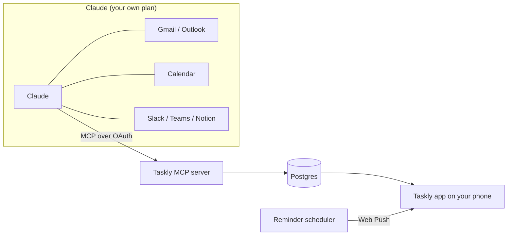

<div align="center">

<picture>
  <source media="(prefers-color-scheme: dark)" srcset="public/brand/taskly-logo-ivory.svg">
  
</picture>

### Your day, sorted by Claude.

An open-source daily to-do app you install on your phone.<br>
Claude turns your mail, calendar and messages into a checklist, and Taskly makes sure you get reminded.

[](https://github.com/ethanfrq/Taskly/releases)
[](LICENSE)


**[Quick start](#quick-start)** · [Self-hosting](docs/self-hosting.md) · [Connect Claude](docs/connect-claude.md) · [Contributing](CONTRIBUTING.md) · [Français](README.fr.md)

<br>

&nbsp;
&nbsp;
&nbsp;


<sub>Today · Agenda · Onboarding · Health check</sub>

</div>

> [!NOTE]
> **Beta.** Every planned feature is in, tested and documented, but no public instance has run Taskly for long yet. [Feedback is welcome](https://github.com/ethanfrq/Taskly/issues).

## Contents

- [Highlights](#highlights)
- [Quick start](#quick-start): [install](#install) · [connect Claude](#connect-claude)
- [How it works](#how-it-works)
- [Self-hosting](#self-hosting)
- [Development](#development)
- [Privacy and security](#privacy)
- [Project status](#status)
- [Contributing](#contributing)

<a id="highlights"></a>

## ✨ Highlights

- 🤖 **Filled by Claude.** Say "Prepare my day in Taskly": Claude turns your Gmail, Outlook, calendars, Slack, Teams or Notion into tasks, each linked to its source.
- 🔔 **Reminders that actually ring.** Push notifications at the exact minute, follow-ups for what matters, quiet hours, morning briefing and evening review.
- ☀️ **One clear day.** A Today checklist with a progress ring and your next meeting, plus a two-week agenda.
- ⌨️ **Type it like you say it.** "Call Paul tomorrow 2pm !!" sets the date, the time and the priority.
- 📱 **An app, not a website.** Installs on iPhone, Android and desktop, and works offline.
- 🔐 **Private by design.** No password, no API key, never your emails: only the tasks.

<details>
<summary><b>All features</b></summary>

<br>

| | |
|---|---|
| **Tasks** | Lists, tags, subtasks, priorities, drag to reorder, recurring tasks (daily, weekdays, weekly, monthly), natural language input |
| **Your day** | Today view with progress ring and next appointment, two-week agenda in time order, carry-over to tomorrow |
| **Claude** | MCP connector with OAuth, one-tap undo of what Claude added, duplicates skipped, cancelled meetings removed, health check, disconnect in one tap |
| **Reminders** | Web Push at the exact minute, follow-ups for priority tasks, snooze, quiet hours, app badge, morning briefing, evening review; "Done" and "Later" from the notification on Android |
| **Focus** | Focus timer (15, 25 or 50 min), weekly stats: streak, completion rate, what Claude helped with |
| **Sharing** | Shared lists with an invite link, tasks assigned to someone |
| **App** | Installable PWA, offline mode with sync, your accent color, light and dark mode with automatic contrast, French and English |
| **Account** | Passkeys (Face ID, Touch ID) or a 6-digit email code, data export as JSON, account deletion |

</details>

<details>
<summary><b>More screenshots</b></summary>

<br>

<p align="center">
  &nbsp;
  &nbsp;
  
</p>

</details>

<a id="quick-start"></a>

## 🚀 Quick start

| I want to… | Go to |
|---|---|
| Use Taskly on my phone | [Install it](#install), then [connect Claude](#connect-claude) |
| Host Taskly for myself or my team | [Self-hosting](#self-hosting) |
| Work on the code | [Development](#development) |

<a id="install"></a>

### 📱 Install it

1. Open your Taskly instance in **Safari** (iPhone) or **Chrome** (Android, desktop).
2. Install it: **Share › Add to Home Screen** on iPhone, **Install app** on Android and desktop.
3. Open Taskly from your home screen and follow the onboarding: account, color, notifications, Claude, and a final check that everything works.

> [!IMPORTANT]
> On iPhone, notifications only work once Taskly is on the home screen (iOS 16.4 or later).

<a id="connect-claude"></a>

### 🤖 Connect Claude

1. In Taskly, open **Settings › Connect Claude** and copy the connector address.
2. In Claude, add it as a **custom connector** and sign in to Taskly to approve.
3. Each morning, ask Claude: **"Prepare my day in Taskly"**.

| Claude plan | What to know |
|---|---|
| Free | One custom connector allowed, so Taskly can be it. Access to the mail and calendar connectors may be limited. |
| Pro / Max | Add Taskly in Claude's connector settings. |
| Team / Enterprise | An organization owner adds Taskly once for everyone. |

The tools Claude gets and the security model: [docs/connect-claude.md](docs/connect-claude.md).

<a id="how-it-works"></a>

## 🧠 How it works

Taskly doesn't call Claude. It's the other way around: Taskly exposes an [MCP](https://modelcontextprotocol.io) server, and Claude, which already reads your mail and calendar through its own connectors, writes the tasks into Taskly.



- **Your Claude plan is enough.** No Anthropic API key, no AI cost for whoever hosts Taskly.
- **Taskly never receives your emails.** Only the tasks Claude creates, with a link back to the source.
- **Taskly works without Claude.** Manual tasks, reminders and the checklist stand on their own.

<a id="self-hosting"></a>

## ☁️ Self-hosting

[](https://vercel.com/new/clone?repository-url=https%3A%2F%2Fgithub.com%2Fethanfrq%2FTaskly&project-name=taskly&repository-name=taskly&env=BETTER_AUTH_SECRET,RESEND_API_KEY,EMAIL_FROM,NEXT_PUBLIC_VAPID_PUBLIC_KEY,VAPID_PRIVATE_KEY,VAPID_SUBJECT&envDescription=Secrets%20for%20sign-in%2C%20email%20codes%20and%20push%20notifications.&envLink=https%3A%2F%2Fgithub.com%2Fethanfrq%2FTaskly%2Fblob%2Fmain%2Fdocs%2Fself-hosting.md%23environment-variables&stores=%5B%7B%22type%22%3A%22integration%22%2C%22integrationSlug%22%3A%22neon%22%2C%22productSlug%22%3A%22neon%22%2C%22protocol%22%3A%22storage%22%7D%5D)

| You need | For | On Vercel |
|---|---|---|
| Postgres | Accounts, tasks, reminders | Neon, offered by the button |
| [Resend](https://resend.com) | Sign-in codes by email | API key |
| VAPID keys | Push notifications | `npx web-push generate-vapid-keys` |
| A scheduler | Reminders at the exact minute | Upstash QStash, from the Marketplace |

Step by step for Vercel or your own server, every environment variable and a troubleshooting table: **[docs/self-hosting.md](docs/self-hosting.md)**.

> [!WARNING]
> Vercel's Hobby plan is for personal, non-commercial use. To host Taskly for a company, use a Pro team.

<a id="development"></a>

## 💻 Development

```bash
git clone https://github.com/ethanfrq/Taskly.git && cd Taskly
```

```bash
npm install
```

```bash
npm run dev
```

Open http://localhost:3000. Nothing to configure: the local database lives in `.data/`, sign-in codes are printed in the terminal and push keys are generated for you. Before pushing:

```bash
npm run lint && npm run typecheck && npm test
```

All the commands, branch and commit conventions are in [CONTRIBUTING.md](CONTRIBUTING.md).

**Stack:** [Next.js](https://nextjs.org) 16 (React 19, TypeScript) · Tailwind CSS 4 · Postgres with [Drizzle](https://orm.drizzle.team) ([PGlite](https://pglite.dev) locally) · [Better Auth](https://www.better-auth.com) (passkeys, email codes, OAuth 2.1) · [MCP TypeScript SDK](https://github.com/modelcontextprotocol/typescript-sdk) · Web Push with [Upstash QStash](https://upstash.com/docs/qstash) · [Vitest](https://vitest.dev). Why each one: [docs/adr](docs/adr/README.md).

<a id="privacy"></a>

## 🔒 Privacy and security

- **Tasks, not emails.** Taskly stores the tasks Claude creates and a link to their source, never the content of your messages.
- **You approve what Claude gets** on Taskly's consent screen, and **Settings › Connect Claude › Disconnect Claude** revokes it at once, even tokens that haven't expired yet.
- **Your data is yours.** Export everything as JSON or delete your account in Settings.
- **Found a vulnerability?** Report it privately, see [SECURITY.md](SECURITY.md).

<a id="status"></a>

## 🗺️ Project status

All five milestones are shipped: **v0.1** Core · **v0.2** Claude · **v0.3** Reminders · **v0.4** Comfort · **v0.5** Sharing. What each one brought, with the pull requests behind it, is in the [v0.5.0 release notes](https://github.com/ethanfrq/Taskly/releases/tag/v0.5.0) and the [milestones](https://github.com/ethanfrq/Taskly/milestones?state=closed).

Next: real-world use. Ideas and bug reports go in [issues](https://github.com/ethanfrq/Taskly/issues).

<a id="contributing"></a>

## 🤝 Contributing

Contributions are welcome, one small pull request at a time. Start with [CONTRIBUTING.md](CONTRIBUTING.md) and the [Code of Conduct](CODE_OF_CONDUCT.md).

The design is documented too: a [clickable prototype](https://htmlpreview.github.io/?https://github.com/ethanfrq/Taskly/blob/main/docs/design/prototype.html) of the whole iPhone flow and every design decision in [docs/design](docs/design/README.md).

## ⚖️ License

[MIT](LICENSE). Taskly is an independent open-source project, not affiliated with, endorsed by or sponsored by Anthropic. Claude is a trademark of Anthropic.
