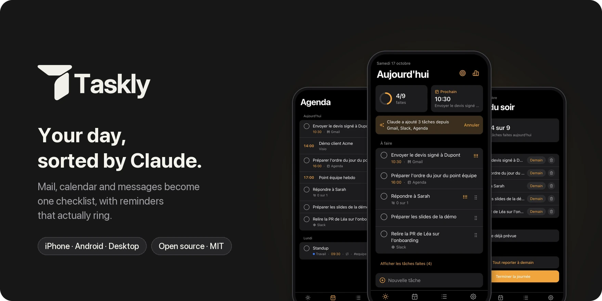
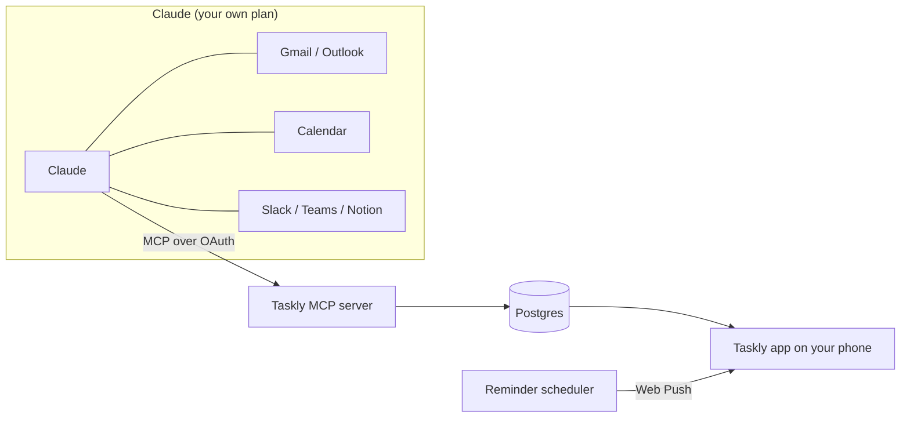

<p align="center">
  
</p>

<p align="center">
  <a href="https://github.com/ethanfrq/Taskly/releases"></a>
  <a href="LICENSE"></a>
  
  
</p>

<p align="center">
  <b><a href="#get-started">Get started</a></b> ·
  <a href="docs/self-hosting.md">Self-hosting</a> ·
  <a href="docs/connect-claude.md">Connect Claude</a> ·
  <a href="CONTRIBUTING.md">Contributing</a> ·
  <a href="README.fr.md">Français</a>
</p>

<br>

Taskly is an **open-source daily to-do app** you install on your phone. You connect it to Claude once; then every morning Claude reads your mail, calendar and messages and fills your day with what actually needs doing. Taskly takes it from there: one clear checklist, and reminders at the right minute.

> [!NOTE]
> **Beta.** Every planned feature is in, tested and documented, but no public instance has run Taskly for long yet. [Feedback welcome.](https://github.com/ethanfrq/Taskly/issues)

## ✨ What it does

<table>
<tr>
<td align="center" valign="top" width="33%">
<br>
<b>🤖 Claude prepares your day</b><br>
<sub>Say “Prepare my day in Taskly”: your mail, calendar and messages become tasks, each linked to its source.</sub>
</td>
<td align="center" valign="top" width="33%">
<br>
<b>📅 One timeline</b><br>
<sub>Meetings and tasks for the next two weeks, in order. Cancelled meetings disappear.</sub>
</td>
<td align="center" valign="top" width="33%">
<br>
<b>🔔 Reminders that ring</b><br>
<sub>At the exact minute, with follow-ups for what matters and quiet hours for the rest.</sub>
</td>
</tr>
<tr>
<td align="center" valign="top" width="33%">
<br>
<b>🌙 Close the day</b><br>
<sub>The evening review shows what's left and moves it to tomorrow in one tap.</sub>
</td>
<td align="center" valign="top" width="33%">
<br>
<b>🎨 Make it yours</b><br>
<sub>Your accent color, light or dark, with contrast adjusted so text stays readable.</sub>
</td>
<td align="center" valign="top" width="33%">
<br>
<b>📊 See your week</b><br>
<sub>Streak, completion rate, focus time and what Claude helped with.</sub>
</td>
</tr>
</table>

**And also**

<table>
<tr>
<td valign="top" width="33%">⌨️ <b>Natural language</b><br><sub>“Call Paul tomorrow 2pm !!” sets date, time and priority</sub></td>
<td valign="top" width="33%">🗂️ <b>Lists, tags, subtasks</b><br><sub>Priorities, drag to reorder, recurring tasks</sub></td>
<td valign="top" width="33%">📴 <b>Works offline</b><br><sub>Check tasks without a connection, synced later</sub></td>
</tr>
<tr>
<td valign="top" width="33%">👥 <b>Shared lists</b><br><sub>Invite link and tasks assigned to someone</sub></td>
<td valign="top" width="33%">🎯 <b>Focus timer</b><br><sub>15, 25 or 50 minutes on one task</sub></td>
<td valign="top" width="33%">🔐 <b>No password</b><br><sub>Face ID / passkeys, or a 6-digit email code</sub></td>
</tr>
<tr>
<td valign="top" width="33%">🩺 <b>Health check</b><br><sub>See that the app, notifications and Claude really work</sub></td>
<td valign="top" width="33%">🌍 <b>French and English</b><br><sub>The whole app, including notifications</sub></td>
<td valign="top" width="33%">📤 <b>Your data</b><br><sub>Export everything as JSON, or delete your account</sub></td>
</tr>
</table>

<a id="get-started"></a>

## 🚀 Get started

<table>
<tr>
<td valign="top" width="33%"><b>📱 Use it</b><br><sub>Open a Taskly instance on your phone, add it to the home screen, follow the two-minute onboarding.</sub><br><br>→ <a href="#install">Install</a> · <a href="#connect-claude">Connect Claude</a></td>
<td valign="top" width="33%"><b>☁️ Host it</b><br><sub>One click on Vercel, or any Node.js server with Postgres. For you, your family or your team.</sub><br><br>→ <a href="#self-hosting">Self-hosting</a></td>
<td valign="top" width="33%"><b>💻 Build it</b><br><sub>Clone, <code>npm install</code>, <code>npm run dev</code>. No account, no key, nothing to configure.</sub><br><br>→ <a href="#development">Development</a></td>
</tr>
</table>

<a id="install"></a>

### 📱 Install it

1. Open your Taskly instance in **Safari** (iPhone) or **Chrome** (Android, desktop).
2. Add it: **Share › Add to Home Screen** on iPhone, **Install app** on Android and desktop.
3. Launch Taskly from the home screen and follow the onboarding: account, color, notifications, Claude.

> [!IMPORTANT]
> On iPhone, notifications only work once Taskly is on the home screen (iOS 16.4 or later).

<a id="connect-claude"></a>

### 🤖 Connect Claude

1. In Taskly, open **Settings › Connect Claude** and copy the connector address.
2. In Claude, add it as a **custom connector**, then sign in to Taskly to approve.
3. Every morning, ask Claude: **“Prepare my day in Taskly”**.

| Your Claude plan | What to know |
|---|---|
| Free | One custom connector allowed: Taskly can be it. Access to mail and calendar connectors may be limited. |
| Pro / Max | Add Taskly in Claude's connector settings. |
| Team / Enterprise | An organization owner adds Taskly once for everyone. |

The tools Claude gets and how access is secured: [docs/connect-claude.md](docs/connect-claude.md).

<a id="how-it-works"></a>

## 🧠 How it works

Taskly never calls Claude. It's the other way around: Taskly exposes an [MCP](https://modelcontextprotocol.io) server, and Claude, which already reads your mail and calendar through its own connectors, writes the tasks into Taskly.



- **Your Claude plan is enough.** No Anthropic API key, no AI bill for whoever hosts Taskly.
- **Taskly never receives your emails.** Only the tasks Claude creates, with a link back to the source.
- **Taskly works without Claude.** Manual tasks, reminders and the checklist stand on their own.

<a id="self-hosting"></a>

## ☁️ Self-hosting

[](https://vercel.com/new/clone?repository-url=https%3A%2F%2Fgithub.com%2Fethanfrq%2FTaskly&project-name=taskly&repository-name=taskly&env=BETTER_AUTH_SECRET,RESEND_API_KEY,EMAIL_FROM,NEXT_PUBLIC_VAPID_PUBLIC_KEY,VAPID_PRIVATE_KEY,VAPID_SUBJECT&envDescription=Secrets%20for%20sign-in%2C%20email%20codes%20and%20push%20notifications.&envLink=https%3A%2F%2Fgithub.com%2Fethanfrq%2FTaskly%2Fblob%2Fmain%2Fdocs%2Fself-hosting.md%23environment-variables&stores=%5B%7B%22type%22%3A%22integration%22%2C%22integrationSlug%22%3A%22neon%22%2C%22productSlug%22%3A%22neon%22%2C%22protocol%22%3A%22storage%22%7D%5D)

| You need | For | On Vercel |
|---|---|---|
| Postgres | Accounts, tasks, reminders | Neon, offered by the button |
| [Resend](https://resend.com) | Sign-in codes by email | An API key |
| VAPID keys | Push notifications | `npx web-push generate-vapid-keys` |
| A scheduler | Reminders at the exact minute | Upstash QStash, from the Marketplace |

Step by step for Vercel or your own server, every environment variable and a troubleshooting table: **[docs/self-hosting.md](docs/self-hosting.md)**.

> [!WARNING]
> Vercel's Hobby plan is for personal, non-commercial use. To host Taskly for a company, use a Pro team.

<a id="development"></a>

## 💻 Development

```bash
git clone https://github.com/ethanfrq/Taskly.git && cd Taskly
```

```bash
npm install
```

```bash
npm run dev
```

Open http://localhost:3000. The local database lives in `.data/`, sign-in codes are printed in the terminal and push keys are generated for you. Before pushing:

```bash
npm run lint && npm run typecheck && npm test
```

Commands, branch and commit conventions: [CONTRIBUTING.md](CONTRIBUTING.md). Technical choices and their trade-offs: [docs/adr](docs/adr/README.md).

| Layer | Built with |
|---|---|
| App | [Next.js](https://nextjs.org) 16, React 19, TypeScript, Tailwind CSS 4 |
| Data | Postgres with [Drizzle](https://orm.drizzle.team); [PGlite](https://pglite.dev) locally and in tests |
| Auth | [Better Auth](https://www.better-auth.com): passkeys, email codes, OAuth 2.1 server for Claude |
| Claude | [MCP TypeScript SDK](https://github.com/modelcontextprotocol/typescript-sdk) |
| Reminders | Web Push, [Upstash QStash](https://upstash.com/docs/qstash) or the server itself |
| Tests | [Vitest](https://vitest.dev) |

<a id="privacy"></a>

## 🔒 Privacy and security

- **Tasks, not emails.** Taskly stores the tasks Claude creates and a link to their source, never the content of your messages.
- **You decide what Claude gets** on Taskly's consent screen. **Settings › Connect Claude › Disconnect Claude** revokes it at once, even tokens that haven't expired.
- **Your data is yours.** Export everything as JSON or delete your account from Settings.
- **Found a vulnerability?** Report it privately: [SECURITY.md](SECURITY.md).

## 🗺️ Status and contributing

All five milestones are shipped: **v0.1** Core · **v0.2** Claude · **v0.3** Reminders · **v0.4** Comfort · **v0.5** Sharing. What each one brought, with its pull requests: [v0.5.0 release notes](https://github.com/ethanfrq/Taskly/releases/tag/v0.5.0) and [milestones](https://github.com/ethanfrq/Taskly/milestones?state=closed).

Contributions are welcome, one small pull request at a time: start with [CONTRIBUTING.md](CONTRIBUTING.md) and the [Code of Conduct](CODE_OF_CONDUCT.md). The design is documented too: a [clickable prototype](https://htmlpreview.github.io/?https://github.com/ethanfrq/Taskly/blob/main/docs/design/prototype.html) of the whole iPhone flow and every decision in [docs/design](docs/design/README.md).

## ⚖️ License

[MIT](LICENSE). Taskly is an independent open-source project, not affiliated with, endorsed by or sponsored by Anthropic. Claude is a trademark of Anthropic.
